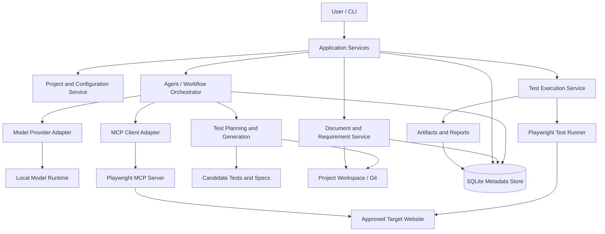

# Architecture — AI-Powered QA Automation Platform

**Document status:** Revised Phase 0 baseline, ready for Phase 1  
**Architecture style:** Local-first modular monolith with replaceable adapters  
**Primary language:** TypeScript  
**Initial interface:** CLI; local web UI later  
**Initial target application:** SauceDemo, followed by at least one different demo web application

---

## 1. Architecture goals

The platform must test different web applications without rewriting its generic core. Application-specific requirements, configuration, data, candidate tests, approved tests, and run artifacts belong to each project. Generic orchestration, MCP integration, execution management, reporting, and release comparison belong to the platform.

Start as a modular monolith rather than separate microservices. Most components are TypeScript modules in one Node.js application. The local AI runtime and Playwright MCP server may run as separate processes because they are external tools. Keep module boundaries clear enough that selected components can be separated later if deployment needs change.

The Phase 1 execution engine must work without AI or MCP. It proves the deterministic test execution path before AI is introduced.

## 2. High-level architecture



The diagram shows logical responsibilities, not separate deployable services. The initial implementation is local-first and driven manually through the CLI. Later, a local web UI will call the same application services.

## 3. Core components

### 3.1 CLI / entry point

Responsibilities:

- Parse commands and validate arguments.
- Select a project and, when applicable, a release.
- Invoke application services rather than implement business logic in CLI handlers.
- Display progress and final status.
- Return a non-zero process exit code when configuration, execution, verification, or required report collection fails.

The CLI is the first interface because it is easier to test than a full dashboard. The later web UI must call the same application services; business logic must not live only in UI code.

### 3.2 Project and configuration service

Responsibilities:

- Create, load, and validate each project configuration.
- Store project ID, name, base URL, approved domains, environment, release information when available, test directory, artifact directory, and references to secret-managed credentials.
- Keep each project's documents, candidate tests, approved tests, and artifacts separated.
- Resolve project-relative paths to absolute paths and reject path traversal outside the project workspace.

The Phase 1 execution configuration is a strict subset of the later project configuration and uses these field names:

```json
{
  "projectId": "saucedemo",
  "name": "SauceDemo Demo",
  "baseUrl": "https://www.saucedemo.com/",
  "environment": "demo",
  "allowedDomains": ["www.saucedemo.com"],
  "testDirectory": "tests/approved",
  "artifactDirectory": "artifacts"
}
```

The example is illustrative. Supported Phase 1 `environment` values are exactly `local`, `development`, `demo`, and `staging`; `production` is rejected. HTTPS is required for non-localhost targets. Plain HTTP is permitted only for `localhost` (including a localhost fixture URL such as `http://localhost`). Phase 2 may add release, workflow-document, role, and authentication fields, but must not rename the Phase 1 fields. `testDirectory` and `artifactDirectory` are relative to the project workspace. Raw passwords, tokens, cookies, and session state must never be stored in the ordinary project JSON file.

In Phase 1, configuration validation must at least confirm required values and URL syntax; verify that the base URL hostname appears in `allowedDomains`; verify that `environment` is one of `local`, `development`, `demo`, or `staging` (reject `production`); permit plain HTTP only for `localhost`; confirm that the configured test directory exists; and ensure resolved paths remain inside the project workspace. This initial check is not a complete browser navigation sandbox. Stronger navigation restrictions are required before autonomous MCP exploration is enabled.

### 3.3 Document and requirement service

Responsibilities:

- Load Markdown and plain-text workflow documents first.
- Preserve original source documents and source references.
- Extract candidate structured requirements and validate model output against a schema.
- Keep requirement IDs, source references, extraction status, and release information.
- Flag missing, ambiguous, or conflicting expected behavior for review.

Structured documents should use author-assigned stable requirement IDs. The same tracked requirement keeps its ID across releases; a new requirement gets a new ID; retired IDs are preserved and never reused. The AI may propose IDs while structuring free-form documents, but a human must approve them before they become authoritative. Each negative case must include its expected outcome. AI observations of current website behavior must not be treated as business requirements.

### 3.4 Model provider adapter

Responsibilities:

- Provide a single internal interface for sending instructions and structured context to a model.
- Implement the first local provider (candidate: Ollama, subject to a feasibility experiment).
- Normalize model outputs and surface malformed responses.
- Apply timeouts, cancellation, logging metadata, and context limits where supported.
- Allow an optional hosted provider to be added later without rewriting agent logic.

Do not couple business logic directly to one provider's response format. Model output is untrusted input and must be parsed and validated.

### 3.5 Agent / workflow orchestrator

Responsibilities:

- Execute bounded workflow steps in a known order.
- Pass each agent only relevant requirements, observations, tools, and project context.
- Store step status, outputs, errors, and attempts.
- Enforce retry limits, timeouts, iteration limits, maximum generated files, and approval checkpoints.
- Stop and surface blockers when the model, browser, or target website cannot proceed.
- Record inspectable tool calls and material decisions while redacting secrets.

Initial agent roles can be ordinary TypeScript modules/functions using the same underlying model:

1. **Requirements Analyst:** extracts and compares requirements.
2. **Explorer:** uses browser tools to gather site observations.
3. **Planner:** proposes test scenarios and categories.
4. **Generator:** creates candidate test files.
5. **Failure Analyst:** summarizes failures using runner evidence and offers clearly labeled hypotheses.

Separate AI models, multi-agent frameworks, or autonomous services are not required for the MVP.

### 3.6 MCP client adapter and Playwright MCP

Responsibilities of the adapter:

- Connect to a configured Playwright MCP server.
- Discover available tools and their input schemas.
- Call tools with validated arguments.
- Return tool observations and errors to the orchestrator.
- Handle connection lifecycle, timeouts, cancellation, and clean shutdown.

Playwright MCP is used for AI-assisted exploration and interaction. It is not the source of truth for automated test pass/fail results. Relevant exploration findings should be saved as observations with project/release context and timestamps where available.

Only approved domains and test environments may be explored. Browser navigation, downloads, file access, and other tool operations must be constrained by platform policy. Website content is untrusted and may contain prompt injection; it must never override platform instructions or expand permissions. MCP snapshot element references are temporary handles and must not be stored as durable locators in generated tests.

### 3.7 Test planning and generation

Responsibilities:

- Combine structured requirements and browser observations.
- Generate candidate scenarios with stable IDs, requirement links, testing-purpose labels, role, preconditions, test-data needs, steps, expected results, priority, risk, dependencies, unresolved questions, and lifecycle status.
- Generate Playwright Test code from approved candidate scenarios.
- Keep generated code in a candidate directory until validation and review.
- Check that generated tests use durable locators and explicit assertions.
- Require meaningful assertions to trace to requirement text, not merely to observed website behavior.

Testing categories are labels, not separate execution engines. MVP categories are functional, end-to-end, black-box, and regression. A scenario can have multiple labels. Categories belong to test scenarios, not to the underlying business requirement record.

### 3.8 Test validation and execution service

Responsibilities:

- Run static/type checks on generated code.
- Execute candidate tests in a controlled workspace during validation.
- Run approved suites for normal executions and release checks.
- Record actual runner results and process information.
- Capture configured artifacts, including JSON/HTML reports, traces, screenshots, and logs.
- Enforce timeouts and limit which tests can run for a project/environment.

The runner invokes Playwright Test as a child process using Node.js directly. Generated tests must not be dynamically evaluated inside the platform's own process. The selected project and run directory are passed to the single platform-owned Playwright configuration using validated environment variables.

### 3.9 Platform-owned Playwright configuration

There is one platform-owned `playwright.config.ts` at the repository root. It is not copied into individual target projects or runner fixtures.

The platform runner provides:

- `QA_PROJECT_CONFIG_PATH`: absolute path to the selected project's `project.config.json`.
- `QA_RUN_DIR`: absolute path to the unique run directory inside that project's configured artifact directory.

The config must fail fast with a clear error if either variable is missing, malformed, inaccessible, or points outside the permitted project/run paths. It must import and use the shared project-config validator/loader from `src/projects/`; it must not duplicate validation rules inside `playwright.config.ts`. It must not silently fall back to a default project or default test directory.

After validating the selected project configuration, the config derives:

- `testDir` from the resolved `testDirectory`.
- `use.baseURL` from `baseUrl`.
- `outputDir` as `<QA_RUN_DIR>/test-output`.
- JSON report output as `<QA_RUN_DIR>/results.json`.
- HTML report output as `<QA_RUN_DIR>/html-report`.
- `retries: 0` for Phase 1.
- Failure artifacts such as `trace: 'retain-on-failure'` and `screenshot: 'only-on-failure'`, where supported by the installed Playwright version.

The HTML report folder must be a sibling of `test-output`, not a child of `outputDir`, because Playwright may clean its output directory at the beginning of a run. Configure the HTML reporter with `open: 'never'` so failed unattended runs do not open a report server and wait for user input.

Do not pass `--pass-with-no-tests`. A run that discovers zero tests is unsuccessful even if another configuration or tool version would otherwise allow an empty suite to exit successfully.

### 3.10 Runner process management

Responsibilities:

- Resolve the installed Playwright CLI entry point from the actual installed package; do not hardcode a guessed `node_modules` path.
- Launch it using `process.execPath`, an argument array, and `shell: false`.
- Set the project root as the working directory and pass the two validated environment variables.
- Capture stdout, stderr, process exit code, signal, start/end time, and timeout state.
- Terminate the process tree/group on timeout and wait for the child exit event.
- Surface process cleanup failures rather than silently continuing.

Initial process termination strategy:

- **Windows:** use `taskkill /T /F /PID <pid>` on timeout and wait for the child process exit event. Verify once manually with Task Manager or `tasklist` that no orphaned Playwright/browser processes remain.
- **Linux/macOS:** start the runner in its own process group, send SIGTERM to the group, wait a short grace period, then send SIGKILL if it has not exited.

Keep OS-specific termination behind a small process-management module. Phase 1 must verify the Windows path on the user's environment; Linux/macOS behavior should have automated or controlled verification when a suitable environment is available.

### 3.11 Report and artifact service

Responsibilities:

- Parse Playwright's machine-readable JSON report, including its top-level `errors` array and test statistics/results.
- Retain the native Playwright HTML report.
- Create a concise CLI summary and store artifact paths.
- Link each result to test ID, requirement IDs when available, release, and environment.
- Distinguish factual runner results from AI-generated explanations.
- Mark missing/partial report collection rather than inventing results.

Each execution gets one collision-safe, UTC timestamp-based run directory under the project's artifact directory, for example:

```text
project-data/
└── saucedemo/
    ├── project.config.json
    ├── tests/
    │   ├── approved/
    │   └── candidates/
    └── artifacts/
        └── 2026-10-31T19-29-05-123Z/
            ├── results.json
            ├── html-report/
            ├── test-output/
            └── logs/
```

A collision-safe suffix may be added to the timestamp. Never overwrite a previous run directory. Ignore generated artifact output in Git, but do not ignore tests or project configuration.

### 3.12 Result and report status model

Keep individual test status, execution run status, and report collection status separate.

**Run result reason:** The run result includes a concise `reason` field when it is not passed. Initial reason codes include `test_failures` (one or more individual tests failed), `no_tests_found`, `exit_report_mismatch`, `cleanup_failed`, `runner_timeout`, `playwright_process_error`, and `report_invalid`. Keep the reason machine-readable and provide a separate human-readable message; do not use free-form prose as the reason code.

**Individual test status (Phase 1):**

- `passed`
- `failed`
- `skipped`

`flaky` is added when retry-based execution is introduced; Phase 1 has retries disabled and must not pretend to produce flaky status.

**Execution run status (Phase 1):**

- `passed`
- `failed`
- `timed_out`
- `infrastructure_error`

A workflow-level status such as `blocked` belongs to the later orchestrator, not to the Phase 1 runner. A zero-test run uses `infrastructure_error` with `reason: "no_tests_found"`; this is an invalid execution configuration/discovery outcome, not a successful empty run.

**Report collection status:**

- `complete`
- `partial`
- `failed`

**Pass invariant:** A run is reported as passed only when the Playwright process exits with code 0, the required JSON report exists and parses, at least one test was discovered, no top-level Playwright run errors are present, and report results are consistent with the process exit. The process and JSON evidence must both be considered.

- If JSON reports test failures, the run is failed even if the process exit code is unexpectedly 0; record the disagreement.
- If the process exits non-zero while individual tests show passed, inspect and display the JSON top-level `errors` array. Setup/teardown/worker errors or an unexplained non-zero exit must never be classified as passed; use `infrastructure_error` when the tests themselves do not explain the process failure.
- If JSON is missing or malformed, result verification failed.
- If zero tests were discovered, classify the run as `infrastructure_error` with `reason: "no_tests_found"`; the report collection itself may still be `complete` if a valid JSON report was successfully collected.
- If the runner-level timeout fires, the run status is `timed_out`; if the required JSON report was not produced, report-collection status is `failed`. The timeout is the primary CLI outcome and must not be replaced by a generic missing-JSON message.
- Required report-collection failure or incompleteness causes a non-zero CLI exit even if test execution itself appeared to pass.
- Preserve the raw exit code, report errors, and relevant stdout/stderr so discrepancies can be diagnosed.

### 3.13 Release comparison and test catalogue

Responsibilities:

- Preserve versioned workflow documents and approved test code in Git.
- Maintain requirement-to-test mappings and run history.
- Compare structured requirement records using stable, author-assigned IDs.
- Classify requirements as new, changed, unchanged, retired, or unresolved.
- Use AI to suggest semantic changes when useful, but require review before changing authoritative requirement identity or meaning.
- Recommend new, updated, or retired tests.
- Keep old versions and approval history for material changes.

Use Git/files for text assets and SQLite for structured metadata. A vector database is not required initially; introduce semantic retrieval only if ordinary retrieval becomes insufficient.

### 3.14 Authentication and role handling

Authentication configuration is introduced in Phase 2; role-aware Playwright setup is implemented when authenticated test workflows are added.

- Store credential values in environment variables or a proper secret mechanism; project JSON may store only environment-variable names.
- `.env` may be used locally only when Git-ignored. `.env.example` may document variable names without real values.
- Use Playwright setup projects and role-specific `storageState` where appropriate.
- Authentication-state files may contain session cookies/tokens and must be Git-ignored, access-restricted, and excluded from logs and prompts.
- Use separate state/accounts for roles or parallel workers when shared mutable state would cause interference.
- Surface CAPTCHA, MFA, SSO, and unsupported login setup as blockers requiring user input.

### 3.15 Later web UI and API

After the CLI workflow is reliable, add a local web UI. A TypeScript React front end with a small Node.js API layer is a possible direction; final tooling choices can wait until the UI phase.

The UI must call the same application services used by the CLI. It must not directly spawn arbitrary model-generated scripts or own the only copy of workflow state.

## 4. Runtime workflow

```mermaid
sequenceDiagram
    actor User
    participant CLI as CLI / UI
    participant App as Application Services
    participant Req as Requirements Service
    participant Agent as Orchestrator + Model
    participant MCP as MCP Client / Playwright MCP
    participant Gen as Planner / Generator
    participant Runner as Playwright Test
    participant Store as Git / Files / SQLite

    User->>CLI: Start project release workflow
    CLI->>App: projectId + releaseId
    App->>Req: Load workflow document
    Req->>Agent: Extract/compare requirements
    Agent->>Store: Save candidate requirements and analysis
    App->>MCP: Explore approved target website
    MCP-->>Agent: Browser observations and errors
    Agent->>Gen: Requirements + observations
    Gen->>Store: Save candidate scenarios and tests
    App->>Runner: Validate/run selected test files
    Runner-->>App: Actual test results and artifact paths
    App->>Store: Save run and report metadata
    App-->>CLI: Summary + unresolved items + report location
    CLI-->>User: Report results; request approvals where needed
```

The first implementation is driven manually from the CLI. Scheduling and release-trigger automation are later additions.

## 5. Repository and project workspace structure

The target structure is:

```text
ai-qa-platform/
├── docs/
│   ├── PROJECT_SPEC.md
│   ├── ARCHITECTURE.md
│   ├── IMPLEMENTATION_PLAN.md
│   └── DECISIONS.md
├── src/
│   ├── cli/
│   ├── application/
│   ├── projects/
│   ├── documents/
│   ├── requirements/
│   ├── agents/
│   ├── model-providers/
│   ├── mcp/
│   ├── test-planning/
│   ├── test-generation/
│   ├── test-execution/
│   ├── releases/
│   ├── reporting/
│   └── storage/
├── tests/
│   ├── unit/
│   │   └── *.test.ts
│   ├── integration/
│   │   └── *.test.ts
│   └── fixtures/
│       └── runner-projects/
│           ├── passing/
│           ├── failing/
│           ├── no-tests/
│           └── hanging/
├── project-data/
│   └── saucedemo/
│       ├── project.config.json
│       ├── requirements/releases/
│       ├── specs/candidates/
│       ├── specs/approved/
│       ├── tests/candidates/
│       ├── tests/approved/
│       └── artifacts/
├── examples/
│   └── saucedemo-reference/
├── playwright.config.ts
├── vitest.config.ts
├── tsconfig.json
├── tsconfig.build.json
├── tsconfig.typecheck.json
├── package.json
└── README.md
```

This is the intended structure as phases are completed; do not create every directory at the beginning. The JavaScript tutorial project remains separate or may be kept as a read-only reference outside the platform repository. The new platform must not import its SauceDemo-specific page objects.

### 5.1 Platform tests vs. target-application tests

- Vitest runs platform unit and integration tests with `.test.ts` naming.
- Playwright Test runs target-application specs with `.spec.ts` naming.
- Vitest `include` must explicitly target `tests/unit/**/*.test.ts` and `tests/integration/**/*.test.ts`.
- Vitest must explicitly exclude `tests/fixtures/**` and `project-data/**`, while retaining normal default exclusions such as dependencies and build output.
- Playwright's one root config receives a single selected `testDir`; it must not discover unrelated platform tests, fixtures, or other target projects.
- Runner fixture projects each have their own minimal `project.config.json`, but no separate Playwright config. They run through the same platform-owned Playwright config as SauceDemo.

### 5.2 TypeScript build and type checking

Use two TypeScript configurations:

- `tsconfig.build.json`: emits only platform source from `src/` into `dist/`.
- `tsconfig.typecheck.json`: uses `noEmit` and includes platform source, root `playwright.config.ts`, Vitest tests, runner fixture TypeScript files, and project Playwright tests.

The base `tsconfig.json` contains shared compiler options. Choose one consistent Node-compatible module system and use it consistently across source, CLI, tests, and scripts. Do not mix CommonJS and ESM patterns without an explicit compatibility reason.

Compile the platform CLI to JavaScript before executing it with Node.js. Playwright loads its TypeScript config and test files directly; the separate no-emit type-check validates them.

## 6. Initial data model

Use stable IDs for entities that survive across releases.

- **Project:** ID, name, configuration, created/updated timestamps.
- **Release:** ID, project ID, version label, target URL/environment, source document references, status.
- **Requirement:** author-assigned stable ID, project ID, title, source text, expected behavior, priority, lifecycle status, source reference, introduced/last-changed release.
- **Test scenario:** stable ID, requirement links, category labels, role, preconditions, steps, expected results, priority, lifecycle status.
- **Test asset:** ID, scenario ID, path, version/commit, candidate/approved/retired status, approval information.
- **Test run:** unique run ID, project/release ID, suite selection, start/end times, process status, report-collection status, runner metadata.
- **Test result:** run ID, test ID, status, duration, error, artifact references.
- **Agent task:** task ID, role, input references, step status, output references, errors, attempt count.
- **Approval record:** reviewer, time, action, asset/version, reason.

Introduce database migrations when SQLite is added. Do not alter database schemas ad hoc without recording the change.

## 7. Candidate, requirement, and run lifecycle states

### Candidate test states

`draft -> generated -> validated -> awaiting approval -> approved`

A candidate may instead become `rejected`, `blocked`, or `needs revision`. Failed candidate validation does not automatically mean the product feature is broken; the test, environment, data, or product may be at fault.

### Requirement change states

`new`, `changed`, `unchanged`, `retired`, `unresolved`.

The AI may recommend a classification. The platform preserves evidence and allows a reviewer to correct it. Authoritative stable IDs are supplied/approved by the author, not independently regenerated by the AI.

### Phase 1 individual test states

`passed`, `failed`, `skipped`.

A future retry-enabled runner may add `flaky`. Do not generate flaky results when retries are disabled.

### Phase 1 run states

`passed`, `failed`, `timed_out`, `infrastructure_error`.

Future workflow orchestration may use `blocked`; this is not a Phase 1 runner state.

### Report-collection states

`complete`, `partial`, `failed`.

A successful run and complete report are separate facts. CLI success requires a verified passing run and complete required report collection.

## 8. Security and safe execution boundaries

- Require explicit configuration of allowed domains.
- Default to local, development, demo, or staging targets; production remains disallowed unless a future explicit safety policy enables a narrowly defined use case.
- Use dedicated test accounts and synthetic test data.
- Keep secrets out of Git, ordinary configuration files, prompts, reports, and logs.
- Treat `.env`, Playwright authentication-state files, cookies, and tokens as sensitive and Git-ignore them.
- Do not perform real payments, send real messages, delete production data, or carry out other consequential actions without explicit project-level authorization and safeguards.
- Run generated test code in a controlled child process/workspace with timeouts, restricted filesystem scope, and no unnecessary privileges.
- Treat uploaded documents, web pages, model outputs, and generated code as untrusted data.
- Do not let text found on a webpage instruct the agent to reveal secrets, change policy, or navigate to unapproved domains.
- Record agent tool calls and significant decisions for debugging and review, while avoiding sensitive values.

## 9. Architecture decisions

The accepted cross-phase decisions and their rationale are recorded in `DECISIONS.md`. That file is the decision log; this architecture document describes the current system design. The implementation order and task completion status remain in `IMPLEMENTATION_PLAN.md`.

## 10. Known limitations

The platform cannot infer every business rule from appearance alone. CAPTCHA, SSO, multi-factor authentication, complex test-data setup, payment integrations, anti-bot controls, and changing sites may require explicit setup or human intervention. Local models vary in tool-calling and code-generation quality. The architecture must surface these limitations honestly rather than claim universal support.

## 11. References

- Playwright TypeScript: https://playwright.dev/docs/test-typescript
- Playwright configuration: https://playwright.dev/docs/test-configuration
- Playwright reporters: https://playwright.dev/docs/test-reporters
- Playwright authentication: https://playwright.dev/docs/auth
- Playwright MCP: https://playwright.dev/docs/getting-started-mcp
- MCP TypeScript SDK v2: https://ts.sdk.modelcontextprotocol.io/v2/
- Ollama tool support: https://registry.ollama.com/blog/tool-support
- Vitest configuration: https://vitest.dev/config/
- Node.js child processes: https://nodejs.org/api/child_process.html
